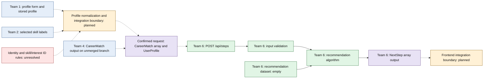

# Team 6 backend roadmap and architecture

This is a living reference for the Next Step Recommendation backend. Verify
the current code, branch, contracts, and test results before relying on it;
update this document when verified facts or agreed decisions change. Baseline:
Phase 1 branch base `db5b81b`, fetched main `87dda38`, Team 4 matching branch
`7e5f32a`; reviewed 2026-11-04. Before the Phase 1 commit, branch
`codex/team6-phase1-compatibility` was at `db5b81b`, two commits behind main;
those main commits add `COMP-CHECKLIST.md` and do not change Team 6's files.

## Intended data flow

Solid arrows show implemented Team 6 flow or an existing data source. Dashed
arrows show planned application connections or an unresolved boundary. The
shared request and response shapes are confirmed interfaces, not proof of an
end-to-end integration.

Legend: **implemented** — Team 6 code exists (the dataset is empty);
**external** — data or code owned outside Team 6; **planned** — integration
not wired; **contract** — shared interface already defined; **decision** —
mapping or ownership remains unresolved. The Team 4 branch is not on main;
the diagram does not imply its output currently reaches the endpoint.

## Phase 1 — Integration compatibility

- **Objectives:** verify cross-team shapes and IDs, resolve compatibility
  within Team 6's scope, and document the application boundary.
- **Relevant files:** `src/types/user.ts`, `src/types/outcomes.ts`,
  `src/lib/journey-progress.ts`, `src/components/profile-form/profileSteps.js`,
  `src/components/skill-selection.tsx`, `public/data/skills.json`,
  `src/data/careers.json`, `public/data/skillToOccupation.json`,
  `src/app/api/steps/route.ts`, `src/lib/next-steps/handler.ts`,
  `src/lib/next-steps-validation.ts`, `src/lib/next-steps-types.ts`,
  `src/lib/next-steps/next-steps.test.ts`, and this directory's README and
  roadmap. External-team files are references, not authorized edit targets.
- **Dependencies:** shared `UserProfile` and `CareerMatch`; application-layer
  decisions listed below. No extra Team 4 feature or dataset is required.
- **Completion criteria:** verified contracts and IDs; focused simulated-match
  tests; unchanged API contract; documented mapping decisions and ownership.
  Implement a pure adapter only when its required identifier rules are known.
- **Status:** contract and boundary changes are ready for review, with
  integration decisions still open. API and shared types remain unchanged.
  Stored profile conversion remains unresolved; no adapter is implemented.
  The normal Team 6 test command passes 69/69 tests. Project-wide TypeScript
  and the production build fail on the pre-existing profile-prop error
  described below. See change tracking for verification results.

The main-branch `COMP-CHECKLIST.md` reinforces clear, predictable inputs and
outputs, agreed shared structures, realistic tests, maintainability, and a
documented handoff. Frontend presentation and accessibility remain outside
Team 6 backend ownership.

## Phase 2 — Backend stabilization

- **Objectives:** correct verified algorithm defects, add regressions, and
  preserve the existing API contract.
- **Relevant files:** `src/lib/next-steps.ts`,
  `src/lib/next-steps-validation.ts`, `src/lib/next-steps/next-steps.test.ts`,
  `src/lib/next-steps/README.md`, and this roadmap; change the handler or Team 6
  types only if the agreed fix requires it.
- **Dependencies:** agree whether prerequisites are ordering hints or
  eligibility requirements; consider incomplete skills data.
- **Completion criteria:** regression coverage for deduplication-induced
  prerequisite cycles and filtered prerequisites, deterministic behavior, and
  existing API tests passing.
- **Status:** not started. An acyclic dataset can become cyclic after dedupe;
  the current ordering fallback may violate the remapped prerequisites.

## Phase 3 — Recommendation dataset

- **Objectives:** create real Team 6-owned recommendation records, verify
  career IDs and rules, and test meaningful outputs.
- **Relevant files:** `src/data/education-steps.json`,
  `src/lib/next-steps-types.ts`, `src/lib/next-steps-validation.ts`,
  `src/lib/next-steps/next-steps.test.ts`, `src/lib/next-steps/README.md`,
  and this roadmap; use `src/data/careers.json` and
  `public/data/skillToOccupation.json` as read-only references.
- **Dependencies:** reviewed sources, defined scope and coverage, and the
  prerequisite semantics from Phase 2. No Team 4 recommendation dataset.
- **Completion criteria:** curated and sourced records, valid existing string
  career IDs, dataset integrity checks, and API tests showing meaningful
  expected results from the bundled dataset.
- **Status:** not started; `education-steps.json` contains an empty `steps`
  array, so valid requests using bundled data return no recommendations.

## Phase 4 — Final backend integration

- **Objectives:** verify compatibility with the completed application, run
  automated tests and a production build, and prepare integration handoff.
- **Relevant files:** `src/app/api/steps/route.ts`,
  `src/lib/next-steps/handler.ts`, `src/lib/next-steps-types.ts`,
  `src/lib/next-steps-validation.ts`, `src/lib/next-steps.ts`,
  `src/data/education-steps.json`, `src/lib/next-steps/next-steps.test.ts`,
  `src/lib/next-steps/README.md`, and this roadmap.
- **Dependencies:** Phases 1–3, agreed application integration boundary,
  available application implementation and installed project dependencies.
- **Completion criteria:** validated real application inputs and outputs,
  passing relevant automated tests and production build, and documented
  handoff with remaining limitations.
- **Status:** not started; no end-to-end application integration is verified.

## Permanent development rules

1. Team 6 owns only the Next Step Recommendation backend.
2. Do not modify frontend components.
3. Do not modify another team's implementation without explicit agreement.
4. Team 4 is not required to provide extra recommendation datasets, custom
   APIs, or additional features for Team 6.
5. Reuse the existing shared `CareerMatch` and `UserProfile` contracts.
6. Do not introduce unnecessary technologies, frameworks, databases, or
   unrelated features.
7. Preserve existing API compatibility unless a change is explicitly approved.
8. All new functionality must have appropriate automated tests.
9. Fix confirmed integration problems before expanding functionality.
10. Keep the implementation aligned with the current TTNS architecture.

## Mandatory workflow for future Team 6 backend coding

1. Read this roadmap before making changes.
2. Compare the proposed change against the roadmap.
3. Check team ownership and shared data contracts against the current code.
4. Confirm that the change belongs to the current development phase.
5. Implement the smallest necessary change.
6. Run relevant tests.
7. Update this roadmap with verified progress, decisions, and new risks.

If a request conflicts with this roadmap, explain the conflict before
implementation. If the repository has legitimately changed, update the
roadmap from verified evidence instead of following stale assumptions.

## Unresolved decisions and risks

- What trusted source supplies `UserProfile.id`, and what lifetime and scope
  should it have? The current profile form does not provide an ID.
- What canonical `skillId` corresponds to each saved skill label? The current
  skill list supplies labels, not separately verified identifiers. How should
  the free-text `primarySkill` relate to the separate skill selection?
- How should free-text interests map to `interestId`? Is an empty `interests`
  array appropriate when interests are unavailable, or must conversion fail?
- How should free-text degree map to `demographics.educationLevel`, if at all?
  Do not infer equivalence or proficiency from a degree or years of experience.
- Who assembles the shared profile and sends the request, and which career
  matches should the application provide? No client currently connects them.
- Is a non-empty selected skill list complete? The current algorithm treats
  an unselected required skill as a gap once any skill is supplied.
- Team 4's match implementation is on an unmerged branch. Main's match route
  is a placeholder; use simulated matches to test Team 6 independently.
- The 500-match validation cap is smaller than the 516 current career IDs.
  Determine intended match-list size before treating it as a defect.
- Dedupe can create prerequisite cycles; filtered prerequisites are only
  ordering hints. Resolve in Phase 2 before depending on those relationships.
- Project-wide TypeScript checking and `pnpm build` fail with TS2741 at
  `src/app/kitchen-sink/page.tsx:59`: `ProfileForm` is rendered without the
  inferred required `onSubmittedChange` prop. The same TypeScript and normal
  production build failure was reproduced from a separate clean archive of
  `origin/main` at `87dda38` with locked dependencies. Team 6 did not modify
  that page or `src/components/profile-form/ProfileForm.js`. The build cannot
  verify later stages until the owning team resolves the project-level error.

## Development tracking

| Date | Phase | File(s) changed | Reason | Related requirement | Test results | Status |
|---|---|---|---|---|---|---|
| 2026-11-04 | 1 | `src/lib/next-steps/README.md`, `src/lib/next-steps/BACKEND_ROADMAP.md`, `src/lib/next-steps/next-steps.test.ts` | Record contracts, integration boundaries and roadmap; add simulated cross-team compatibility tests. | Phase 1 compatibility and permanent roadmap | Normal `pnpm test`: 69/69 pass. Project TypeScript and production build fail at `src/app/kitchen-sink/page.tsx:59` with TS2741, also reproduced on clean `origin/main` `87dda38`; Team 6 did not modify affected files. Mermaid rendering remains unverified. | Ready for Phase 1 review; profile integration decisions and project build blocker remain open |
