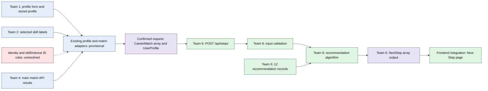

# Team 6 backend roadmap and architecture

This is a living reference for the Next Step Recommendation backend. Verify
the current code, branch, contracts, and test results before relying on it;
update this document when verified facts or agreed decisions change. Current integration work is based on `origin/main` commit `244df21`, fetched 2026-11-26.
Phase 1 was merged in PR #25; its earlier verification is retained below as
history, not as the current build or integration status.

## Intended data flow

The application now calls the backend through the existing adapters. Guest
identity and label-based identifiers are explicitly local; authenticated
identity and canonical IDs remain future decisions.

Legend: **implemented** — Team 6 code exists;
**external** — data or code owned outside Team 6; **planned** — integration
not wired; **contract** — shared interface already defined; **decision** —
mapping or ownership remains unresolved. The Next Step page sends an assembled
request for the first selected current career.

## Phase 1 — Integration compatibility

- **Objectives:** verify cross-team shapes and IDs, resolve compatibility
  within Team 6's scope, and document the application boundary.
- **Relevant files:** `src/types/user.ts`, `src/types/outcomes.ts`,
  `src/lib/journey-progress.ts`, `src/components/profile-form/profileSteps.js`,
  `src/components/skill-selection.tsx`, `public/data/skills.json`,
  `src/data/careers.json`, `public/data/skillToOccupation.json`,
  `src/app/api/steps/route.ts`, `src/lib/next-steps/handler.ts`,
  `src/lib/next-steps-validation.ts`, `src/lib/next-steps-types.ts`,
  `src/lib/next-steps/next-steps.test.ts`, and this directory's README and
  roadmap. External-team files are references, not authorized edit targets.
- **Dependencies:** shared `UserProfile` and `CareerMatch`; application-layer
  decisions listed below. No extra Team 4 feature or dataset is required.
- **Completion criteria:** verified contracts and IDs; focused simulated-match
  tests; unchanged API contract; documented mapping decisions and ownership.
  Implement a pure adapter only when its required identifier rules are known.
- **Status:** the Next Step page uses both adapters with a browser-local guest
  ID, explicit local label identifiers and the first selected current career.
  API and shared types remain unchanged; production identity decisions remain.

The main-branch `COMP-CHECKLIST.md` reinforces clear, predictable inputs and
outputs, agreed shared structures, realistic tests, maintainability, and a
documented handoff. Frontend presentation and accessibility remain outside
Team 6 backend ownership.

## Phase 2 — Backend stabilization

- **Objectives:** correct verified algorithm defects, add regressions, and
  preserve the existing API contract.
- **Relevant files:** `src/lib/next-steps.ts`,
  `src/lib/next-steps-validation.ts`, `src/lib/next-steps/next-steps.test.ts`,
  `src/lib/next-steps/README.md`, and this roadmap; change the handler or Team 6
  types only if the agreed fix requires it.
- **Dependencies:** agree whether prerequisites are ordering hints or
  eligibility requirements; consider incomplete skills data.
- **Completion criteria:** regression coverage for deduplication-induced
  prerequisite cycles and filtered prerequisites, deterministic behavior, and
  existing API tests passing.
- **Status:** in progress. A deduplication-induced cycle now fails closed
  instead of emitting an invalid order; regression tests cover it. A filtered
  prerequisite is still an ordering hint, not an eligibility condition.

## Phase 3 — Recommendation dataset

- **Objectives:** create real Team 6-owned recommendation records, verify
  career IDs and rules, and test meaningful outputs.
- **Relevant files:** `src/data/education-steps.json`,
  `src/lib/next-steps-types.ts`, `src/lib/next-steps-validation.ts`,
  `src/lib/next-steps/next-steps.test.ts`, `src/lib/next-steps/README.md`,
  and this roadmap; use `src/data/careers.json` and
  `public/data/skillToOccupation.json` as read-only references.
- **Dependencies:** reviewed sources, defined scope and coverage, and the
  prerequisite semantics from Phase 2. No Team 4 recommendation dataset.
- **Completion criteria:** curated and sourced records, valid existing string
  career IDs, dataset integrity checks, and API tests showing meaningful
  expected results from the bundled dataset.
- **Status:** in progress; the bundled data contains nine skill-gap steps and
  three generic application/experience steps covering 16 of 516 career IDs.
  Simulated compatible requests produce real bundled recommendations. Coverage
  and the suitability of each recommendation still require review.

## Phase 4 — Final backend integration

- **Objectives:** verify compatibility with the completed application, run
  automated tests and a production build, and prepare integration handoff.
- **Relevant files:** `src/app/api/steps/route.ts`,
  `src/lib/next-steps/handler.ts`, `src/lib/next-steps-types.ts`,
  `src/lib/next-steps-validation.ts`, `src/lib/next-steps.ts`,
  `src/data/education-steps.json`, `src/lib/next-steps/next-steps.test.ts`,
  `src/lib/next-steps/README.md`, and this roadmap.
- **Dependencies:** Phases 1–3, agreed application integration boundary,
  available application implementation and installed project dependencies.
- **Completion criteria:** validated real application inputs and outputs,
  passing relevant automated tests and production build, and documented
  handoff with remaining limitations.
- **Status:** a local browser journey reached the API and displayed its
  response. Production deployment and wider dataset coverage remain unverified.

## Permanent development rules

1. Team 6 owns the Next Step Recommendation backend. On 2026-11-26 Joshua
   explicitly authorized the cross-team frontend integration in this branch;
   this is a task-specific exception to rules 2 and 3, not a transfer of ownership.
2. Do not modify frontend components.
3. Do not modify another team's implementation without explicit agreement.
4. Team 4 is not required to provide extra recommendation datasets, custom
   APIs, or additional features for Team 6.
5. Reuse the existing shared `CareerMatch` and `UserProfile` contracts.
6. Do not introduce unnecessary technologies, frameworks, databases, or
   unrelated features.
7. Preserve existing API compatibility unless a change is explicitly approved.
8. All new functionality must have appropriate automated tests.
9. Fix confirmed integration problems before expanding functionality.
10. Keep the implementation aligned with the current TTNS architecture.

## Mandatory workflow for future Team 6 backend coding

1. Read this roadmap before making changes.
2. Compare the proposed change against the roadmap.
3. Check team ownership and shared data contracts against the current code.
4. Confirm that the change belongs to the current development phase.
5. Implement the smallest necessary change.
6. Run relevant tests.
7. Update this roadmap with verified progress, decisions, and new risks.

If a request conflicts with this roadmap, explain the conflict before
implementation. If the repository has legitimately changed, update the
roadmap from verified evidence instead of following stale assumptions.

## Unresolved decisions and risks

- What trusted source supplies `UserProfile.id`, and what lifetime and scope
  should it have? The current profile form does not provide an ID.
- What canonical `skillId` corresponds to each saved skill label? The current
  skill list supplies labels, not separately verified identifiers. How should
  the free-text `primarySkill` relate to the separate skill selection?
- How should free-text interests map to `interestId`? Is an empty `interests`
  array appropriate when interests are unavailable, or must conversion fail?
- How should free-text degree map to `demographics.educationLevel`, if at all?
  Do not infer equivalence or proficiency from a degree or years of experience.
- Who assembles the shared profile and sends the request, and which career
  matches should the application provide? The current page sends the first selected current match; the integration group can revisit this policy.
- Is a non-empty selected skill list complete? The current algorithm treats
  an unselected required skill as a gap once any skill is supplied.
- Main's Team 4 match route returns `code`, `matchPercentage`, and string
  rationale; the existing `toStepsMatches` converts those fields for Team 6.
  No new Team 4 endpoint or recommendation data is required.
- The 500-match validation cap is smaller than the 516 current career IDs.
  Determine intended match-list size before treating it as a defect.
- A deduplication-induced cycle now returns a generic 500 instead of an
  incorrect ordering. The semantics of prerequisites omitted by filtering
  remain ordering-only and need agreement before use as eligibility rules.
- When duplicate records share a `dedupeKey`, the kept record's own
  prerequisites are used; prerequisites on a dropped duplicate are not
  merged. Dataset authors should keep equivalent records consistent until
  the desired semantics are agreed.
- The earlier `ProfileForm` build error was recorded against main
  `87dda38`. At baseline `8cd20de`, TypeScript and the production build
  pass; Team 6 did not modify the profile implementation.
- The separate frontend branch expects priority and action fields that the
  shared `NextStep` output does not provide. Display mapping needs agreement.
- `match-adapter.test.ts` is compiled by the projection config but is not
  selected by its current Node test command; its eight tests passed when run
  separately. Its owner should decide how to include that suite. Team 6 tests
  also cover the adapter at the API boundary.

## Development tracking

| Date | Phase | File(s) changed | Reason | Related requirement | Test results | Status |
|---|---|---|---|---|---|---|
| 2026-11-04 | 1 | `src/lib/next-steps/README.md`, `src/lib/next-steps/BACKEND_ROADMAP.md`, `src/lib/next-steps/next-steps.test.ts` | Record contracts, integration boundaries and roadmap; add simulated cross-team compatibility tests. | Phase 1 compatibility and permanent roadmap | Normal `pnpm test`: 69/69 pass. Project TypeScript and production build fail at `src/app/kitchen-sink/page.tsx:59` with TS2741, also reproduced on clean `origin/main` `87dda38`; Team 6 did not modify affected files. Mermaid rendering remains unverified. | Ready for Phase 1 review; profile integration decisions and project build blocker remain open |
| 2026-11-24 | 2 / integration | `src/lib/next-steps.ts`, `src/lib/next-steps/handler.ts`, `src/lib/next-steps/next-steps.test.ts`, `src/lib/next-steps/README.md`, `src/lib/next-steps/BACKEND_ROADMAP.md` | Simplify gap checks, fail closed on deduplication cycles, preserve the error response and test existing adapters against real data. | Backend stabilization and cross-team compatibility | Baseline: Team 6 67/69, projection 32/32, TypeScript and build pass, lint 6 existing warnings. After changes: Team 6 78/78 and projection 32/32 pass; TypeScript and build pass; lint retains the same 6 warnings. | Ready for backend review; integration decisions remain open |

| 2026-11-26 | 4 / application integration | `src/app/next-step/page.tsx`, `src/components/next-steps/NextStepsList.tsx`, `src/data/education-steps.json`, `src/lib/journey-progress.ts`, `src/lib/profile-adapter.ts`, tests and documentation | Connect the real journey using a guest ID, selected career, conservative skill completeness and actual API responses; remove assumptions about a newly chosen skill from generic records. | Explicit cross-team integration authorization | `pnpm test`: 79 Team 6 and 32 projection tests pass; 8 additional match-adapter tests pass; TypeScript and production build pass; lint has 5 existing warnings. Local browser: supported 12201 returned recommendations, unsupported 52111 showed labeled guidance; API error state exercised. | Integration implemented; production identity, canonical IDs, education mapping and broader dataset coverage remain open. Team 5 projection-weight fix is under separate PR #50. |
